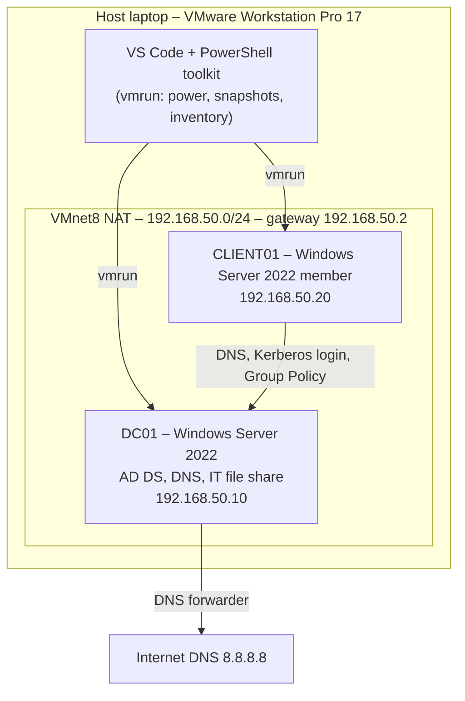

# KVLab – Design Document

## 1. Purpose
A small Windows domain for 10+ users in IT and HR, built on VMware Workstation to practise
VMware virtualization, Windows Server administration, Active Directory, DNS, Group Policy,
PowerShell automation, and backup and recovery.

## 2. Architecture

## 3. Components

| VM | Role | OS | IP | RAM | Disks |
| --- | --- | --- | --- | --- | --- |
| DC01 | Domain controller, DNS, file share | Windows Server 2022 Standard (Desktop Experience) | 192.168.50.10 | 2 GB | 60 GB system + 20 GB backup (E:) |
| CLIENT01 | Domain member for testing logins and GPOs | Windows Server 2022 Standard (Desktop Experience) | 192.168.50.20 | 2 GB | 60 GB |

## 4. Active Directory design
- **Domain:** kvlab.local (NetBIOS: KVLAB), single forest, single domain controller.
- **OU structure:** KVLab → Users, Groups, Computers, Servers.
- **Groups:** IT-Team, HR-Team (Global security groups). Permissions are granted to groups, never to individual users.
- **Users:** created in bulk from CSV with PowerShell; forced password change at first login.

## 5. DNS design
- AD-integrated forward zone kvlab.local and reverse zone for 192.168.50.0/24.
- Forwarder 8.8.8.8 for internet names.
- Records: client01 (A + PTR), files (CNAME to dc01).

## 6. Group Policy
| GPO | Linked to | Targeting | Setting |
| --- | --- | --- | --- |
| Default Domain Policy | Domain | All | Password min 12, complexity, 90-day expiry, lockout after 5 tries |
| HR-Restrict-ControlPanel | KVLab/Users | Security filtering: HR-Team (Authenticated Users keep Read) | Prohibit Control Panel and PC settings |
| IT-Map-Drive-I | KVLab/Users | Item-level targeting: IT-Team | Map I: to the IT share |

## 7. Security
- Strong password and lockout policy.
- Least privilege through groups; share and NTFS permissions both set.
- DSRM recovery password stored offline.
- Lab passwords are for this isolated lab only.

## 8. Backup and recovery
| Method | Protects against | Tested |
| --- | --- | --- |
| Windows Server Backup – system state to E: | Loss or corruption of the domain controller | Backup completed |
| Windows Server Backup – files (C:\Lab, C:\Shares) | Deleted or damaged files | Deleted script restored |
| AD Recycle Bin | Accidentally deleted users or groups | Deleted user restored with group membership |
| VM snapshots (VMware) | A bad change; quick rollback | Created, listed and rotated with the toolkit |

Snapshots are for short-term rollback around a change, not backups. In a multi-DC
production domain, DC snapshots must not be reverted (USN rollback risk).

## 9. Automation
- **VMware toolkit (host):** inventory to CSV, power, snapshot create/revert/delete/rotate, clones, all via vmrun with logging.
- **Windows scripts (DC01):** bulk user creation, inactive-account report/disable, disk space report (scheduled daily), DC health check.

## 10. Future improvements
- Second domain controller (DC02) for high availability.
- Separate file server; DFS namespace.
- Central monitoring and alerting.
- Move from VMware Workstation to ESXi + vCenter and port the toolkit to PowerCLI.